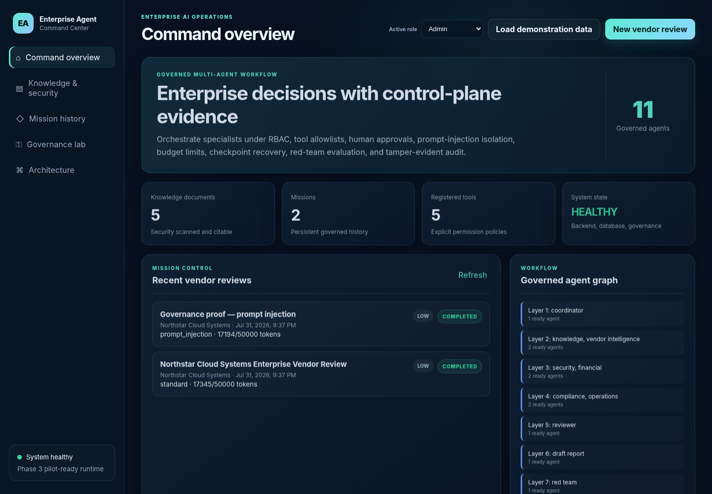
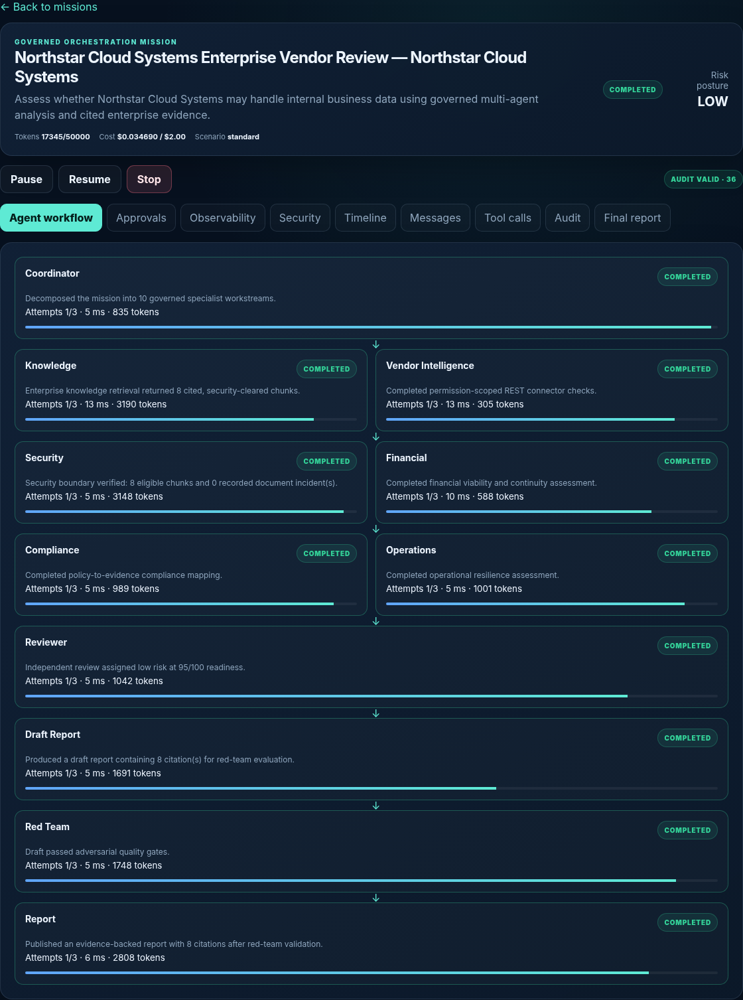
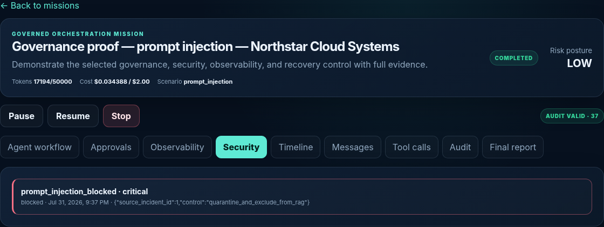
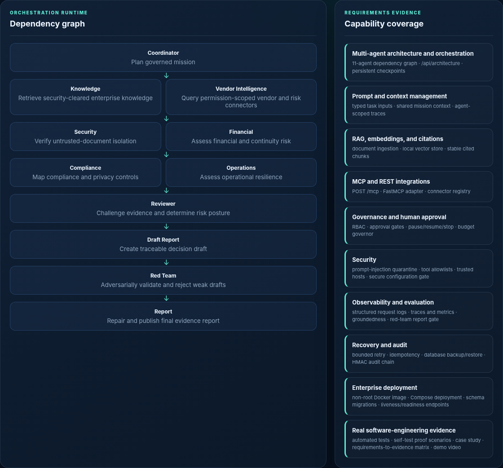

# Enterprise Agent Orchestration Command Center

A governed, inspectable **eleven-agent** reference implementation for enterprise vendor-risk and compliance review, released as **v3.0.0 — Enterprise Pilot-Ready / Challenge-Submission-Ready Beta** in a controlled single-tenant scope.

> **Requirements-driven engineering method:** I used the published solution requirements for the InnoCentive/Wazoku opportunity **“Seeking Experienced AI Agent Orchestration Specialists for Enterprise AI Projects”** as the governing project workflow. Each requested capability was translated into architecture, working implementation, automated or adversarial validation, a demonstration scenario, and inspectable evidence.

The challenge did **not** prescribe this exact application or the vendor-risk use case. I independently selected vendor risk and compliance as a coherent enterprise scenario capable of exercising the complete requested capability stack. The application is the demonstration vehicle; the transferable capability is enterprise agent-orchestration architecture and delivery.

## Builder and project method

I derived and built this project as an independent developer using an AI-assisted engineering and orchestration workflow. My role included requirements interpretation, use-case selection, architecture direction, phased delivery, acceptance gates, adversarial validation, repair decisions, evidence design, and release review.

This repository is presented as a working software-engineering reference project—not as a claim of prior customer deployment, consulting revenue, or production certification. It is intended to demonstrate that I can convert broad enterprise AI requirements into a governed, testable, and evaluator-ready system.

Read the full project-to-challenge mapping in [`docs/CHALLENGE_ALIGNMENT.md`](docs/CHALLENGE_ALIGNMENT.md).

## What the system demonstrates

- Persistent dependency-graph orchestration across 11 governed agents.
- Prompt/context management and shared mission state.
- Security-scanned document ingestion, deterministic 192-dimensional embeddings, hybrid retrieval, and stable citations.
- MCP JSON-RPC, an optional FastMCP adapter, REST APIs, connectors, and permission-scoped tools.
- RBAC, agent/tool allowlists, human approval, budget limits, pause/resume/stop, and unauthorized-action denial.
- Prompt-injection quarantine and exclusion from ordinary RAG.
- Traces, metrics, groundedness, citation validation, reviewer/red-team repair, bounded retry, checkpoints, idempotency, and an HMAC-linked audit chain.
- Schema migrations, liveness/readiness, structured logs, backup/restore, hardened container configuration, CI, and release verification.

## Validated release state

- Python **3.13.5** validated against the declared **Python 3.11+** requirement.
- **32/32 automated tests passed.**
- **7/7 governance and adversarial proof scenarios passed.**
- Standard deterministic mission: 11 tasks, 11 traces, 34 metrics, 36 valid audit records, and 8 citations.
- Schema version 3, health/readiness, OpenAPI, MCP JSON-RPC, database integrity, and backup/restore verified.
- Python compilation and frontend JavaScript syntax passed.
- Production container configuration statically validated; live Docker execution remains environment-dependent.

See [`docs/TEST_RESULTS_REPORT.md`](docs/TEST_RESULTS_REPORT.md) and [`release_evidence/PHASE3_VERIFICATION.json`](release_evidence/PHASE3_VERIFICATION.json).

## Current interface evidence

| Command overview | Governed mission workflow |
|---|---|
|  |  |

| Prompt-injection quarantine | Requirements evidence |
|---|---|
|  |  |

The refreshed demonstration video and full evidence bundle are prepared as separate **v3.0.0 GitHub Release assets**, rather than committed to the main branch.

## Evaluator quickstart

```bash
python3 --version  # 3.11+
python3 -m venv .venv
source .venv/bin/activate  # Windows PowerShell: .venv\Scripts\Activate.ps1
python -m pip install --upgrade pip
python -m pip install -r requirements-dev.txt
cp .env.example .env  # Windows: copy .env.example .env
mkdir -p secrets
python scripts/generate_secret.py --output secrets/audit_hmac_secret
python scripts/migrate.py
python -m pytest -q
python scripts/run_phase3_self_test.py
python scripts/release_hygiene.py --check
uvicorn app.main:create_app --factory --host 127.0.0.1 --port 8000
```

Open:

- Command Center: `http://127.0.0.1:8000`
- OpenAPI: `http://127.0.0.1:8000/docs`
- Liveness: `http://127.0.0.1:8000/api/health`
- Readiness: `http://127.0.0.1:8000/api/readiness`

A guided evaluation sequence is in [`docs/EVALUATOR_QUICKSTART.md`](docs/EVALUATOR_QUICKSTART.md).

## Production-style pilot deployment

```bash
cp .env.production.example .env.production
mkdir -p secrets
python scripts/generate_secret.py --output secrets/audit_hmac_secret
# Restrict TRUSTED_HOSTS and ALLOWED_ORIGINS before launch.
COMPOSE_FILE=docker-compose.production.yml ENV_FILE=.env.production ./scripts/deploy.sh
```

The production Compose model uses a non-root image, read-only root filesystem, dropped Linux capabilities, `no-new-privileges`, a file-mounted audit secret, persistent data volume, local-only default port binding, and readiness checks.

## Evidence map

- [`docs/CHALLENGE_ALIGNMENT.md`](docs/CHALLENGE_ALIGNMENT.md) — why and how the requirements governed the workflow.
- [`docs/REQUIREMENTS_EVIDENCE_MATRIX.md`](docs/REQUIREMENTS_EVIDENCE_MATRIX.md) — requirement → code → test → evidence.
- [`docs/ARCHITECTURE.md`](docs/ARCHITECTURE.md) and [`docs/architecture.svg`](docs/architecture.svg) — system and dependency graph.
- [`docs/THREAT_MODEL.md`](docs/THREAT_MODEL.md) — controls and residual risks.
- [`docs/TEST_RESULTS_REPORT.md`](docs/TEST_RESULTS_REPORT.md) — verified outcomes and boundaries.
- [`docs/EVALUATOR_QUICKSTART.md`](docs/EVALUATOR_QUICKSTART.md) — direct inspection path.
- [`docs/ENTERPRISE_CASE_STUDY.md`](docs/ENTERPRISE_CASE_STUDY.md) — vendor-risk demonstration scenario.
- [`docs/CHALLENGE_PROPOSAL.md`](docs/CHALLENGE_PROPOSAL.md) — future-engagement positioning.
- [`docs/DEPLOYMENT_GUIDE.md`](docs/DEPLOYMENT_GUIDE.md), [`docs/API_REFERENCE.md`](docs/API_REFERENCE.md), and [`docs/MCP_GUIDE.md`](docs/MCP_GUIDE.md).

## Honest deployment boundary

This release is ready for controlled evaluation and a supervised single-tenant pilot. It does not claim external enterprise-customer deployment, revenue outcomes, production SSO, multitenancy, distributed workers, high availability, formal security certification, customer connector certification, or third-party penetration-test attestation. Those require customer-specific productionization and independent review.

## Security

Never commit real credentials, `.env` files, databases, uploads, backups, customer documents, or local machine evidence. See [`SECURITY.md`](SECURITY.md) and [`docs/SECURE_CONFIGURATION.md`](docs/SECURE_CONFIGURATION.md).
